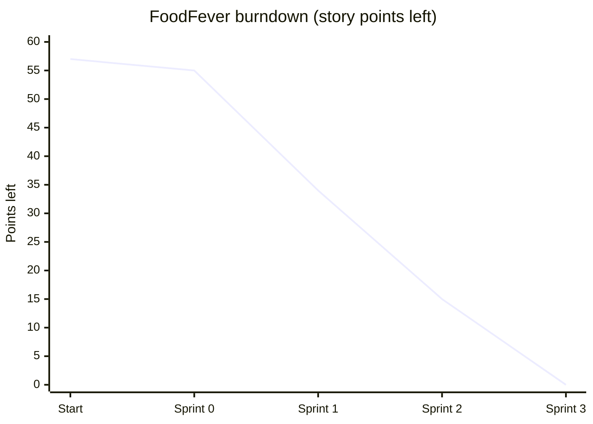

# 3. Methodology and Planning

## 3.1 Introduction

This chapter is about how we managed the FoodFever project. I explain why our group went with Scrum, who did what, how we planned the sprints, what we finished in each one and how we managed the risks along the way.

## 3.2 Why We Chose Scrum

FoodFever is a web app where Strathmore students and staff can order food from the campus cafeteria and have it brought to their hostel, lecture hall or the library. Vendors get their own dashboard where they see the orders coming in. We used Scrum, an Agile framework, to build it.

The main reason we picked Scrum is that we didn't know all the requirements at the start. The first prototype only had a menu and a cart. Things like login, profiles, order tracking, order history and the vendor dashboard only came up later as we kept discussing the idea. Even the parts we had planned kept changing once we saw each other's work. The order statuses ended up as Pending, Preparing and Ready, the sign-up form got separate student and vendor roles, and the look of the menu was redone more than once. If we had used Waterfall, we would have had to write all of that down and design it before coding anything. Every new idea would have sent us back to the beginning. With Scrum we just added it to the backlog and picked it up in the next sprint.

The system also broke down nicely into modules: menu and cart, ordering and tracking, login and profiles, and the vendor dashboard. So we could give one module to each developer and everyone could work at the same time on their own Git branch. When a module was ready it was merged through a pull request.

We also had a fixed deadline. With short sprints it was easy to tell if we were falling behind, and when we were, we could drop the less important features instead of rushing everything at the end. Online payment and a proper database ended up being dropped and are now listed as future work.

Lastly, the documentation is marked together with the system. Since us documentors were working in the same sprints as the developers, we could write our chapters while the features were being built, instead of trying to put the whole report together at the end.

Before settling on Scrum we also looked at a few other approaches:

| Methodology | How it works | Why we didn't pick it |
|---|---|---|
| Waterfall | One phase after another (requirements, design, coding, testing), with no going back | Too rigid. A late change in requirements is expensive, and there is nothing to show until the very end |
| Spiral | Repeated cycles with a big focus on risk analysis | Made for large, high-risk projects. The risk analysis in every cycle was too heavy for a web app this size |
| Prototyping | Build quick versions of the interface and improve them with feedback | Useful for the screens, so we did use it inside our sprints, but it doesn't cover the whole life cycle on its own |
| Kanban | Continuous flow of tasks on a board, no fixed sprints | No fixed delivery points, which we needed for the course deadline. We still used a Kanban-style board, but only to track tasks |
| **Scrum** | Short fixed sprints, a prioritised backlog, clear roles and regular reviews | **Chosen.** It handles changing requirements, gives us something working at the end of every sprint and lets developers and documentors work side by side |

Scrum is defined in the Scrum Guide (Schwaber and Sutherland, 2020) as a lightweight framework built on three pillars: transparency, inspection and adaptation. In our project, transparency came from the shared backlog and the evening updates on WhatsApp, inspection from testing each increment at the end of a sprint, and adaptation from the changes we agreed on in each retrospective.

## 3.3 Team Roles

| Scrum role | Who | What they do |
|---|---|---|
| Product Owner | Harshvir Singh Ahuja | Owns the project and the GitHub repo, decides what goes into each sprint, reviews and merges pull requests |
| Scrum Master | Aaron Kiuna | Runs the meetings, checks on anyone who is stuck and keeps the sprint on track |
| Development team | Harshvir Singh Ahuja, David Kiki, Justin Mukunzi, Keith Muleshe | Build and test the features |
| Documentors | Aaron Kiuna, Sahra, Mnadhiri Simeon Charles, Mathew Keah, Allan Mwangi | Write the report, one chapter each |

This is how we split the report:

| Documentor | Name | Chapter |
|---|---|---|
| 1 | Aaron Kiuna | Introduction and project overview |
| 2 | Sahra | System requirements |
| 3 | Mnadhiri Simeon Charles | Methodology and planning |
| 4 | Mathew Keah | System design |
| 5 | Allan Mwangi | Testing and user guide |

And on the development side, each developer took a module:

| Module | Developer | Branch |
|---|---|---|
| Repo setup, first prototype, README | Harshvir Singh Ahuja | `main` |
| Menu, cart and checkout | David Kiki | `feature/david-menu-cart` |
| Ordering, tracking and order history | Justin Mukunzi | `feature/ordering-and-tracking` |
| Login, sign-up and profiles | Keith Muleshe | `feature/login---sign-in` |
| Vendor dashboard | Harshvir Singh Ahuja | `feature/dashboard` |

Harshvir and Justin were also the ones who reviewed and merged pull requests into `main`.

## 3.4 How We Ran Each Sprint

At the start of every sprint Aaron, as our Scrum Master, called a planning meeting where we agreed on a goal and chose which user stories from the backlog we would work on. During the sprint we did our check-ins every evening on our WhatsApp group. Each person would post where they had reached that day, what they were doing next and if anything was blocking them. At the end of the sprint we looked at what had been merged, tested it in the browser and talked about what we should do differently next time.

A story was only counted as done if:

1. it worked in the browser with no errors in the console
2. it was merged into `main` through a pull request
3. it still worked with the other modules (for example the cart still passed the order to checkout properly)
4. the documentors had been told about it so we could update the report

## 3.5 Product Backlog

We used MoSCoW for priority (Must, Should, Could) and story points to estimate the size of each story, with 1 being very small and 8 being large.

| ID | User story | Priority | Points | Sprint |
|---|---|---|---|---|
| PB-01 | As a team, we need a shared repository and a basic page so we can start building. | Must | 2 | 0 |
| PB-02 | As a student, I want to browse the cafeteria menu so I can see what's available. | Must | 3 | 1 |
| PB-03 | As a student, I want to add items to a cart and see the total so I know what I'll pay. | Must | 5 | 1 |
| PB-04 | As a student, I want to choose where the food is delivered (hostel, lecture hall, library). | Must | 3 | 1 |
| PB-05 | As a student, I want to place an order and get a confirmation. | Must | 5 | 1 |
| PB-06 | As a student, I want to track my order so I know when it's coming. | Should | 5 | 1 |
| PB-07 | As a student, I want to see my past orders. | Should | 3 | 2 |
| PB-08 | As a user, I want to sign up and log in so my details stay private. | Must | 5 | 2 |
| PB-09 | As a student or vendor, I want a profile page where I can see and edit my details. | Should | 3 | 2 |
| PB-10 | As a vendor, I want a dashboard showing incoming orders so I can prepare them. | Must | 8 | 2 |
| PB-11 | As a team, we want everything tested and the bugs fixed before the demo. | Must | 5 | 3 |
| PB-12 | As a lecturer, I want a complete report and user guide to assess the project. | Must | 5 | 3 |
| PB-15 | As a user, I want every page to have the same look and navigation so the site is easy to use. | Should | 3 | 3 |
| PB-16 | As a user, I want a contact page so I can send questions to the team. | Could | 2 | 3 |
| PB-13 | As a student, I want to pay with M-Pesa so I don't need cash. | Could | 8 | Future |
| PB-14 | As a team, we want the pages connected to a backend and database so students and vendors see the same orders. | Could | 8 | Future (prototype started in Sprint 3) |

## 3.6 Sprint Plans

We started the project on 25 October and finished on 10 November 2026.

| Sprint | Dates | Goal | Stories |
|---|---|---|---|
| 0 | 25 Oct – 1 Nov 2026 | Set up the repo and build a simple prototype | PB-01 |
| 1 | 2 – 5 Nov 2026 | A student can browse the menu, fill a cart, check out and track the order | PB-02 to PB-06 |
| 2 | 6 – 9 Nov 2026 | Add accounts, order history and the vendor dashboard, and join all the modules | PB-07 to PB-10 |
| 3 | 10 Nov 2026 | Shared design and contact page, testing, bug fixes and finishing the report | PB-11, PB-12, PB-15, PB-16 |

In Sprint 0 we set up the repo, agreed to use plain HTML, CSS and JavaScript (no backend for now), made the `css`, `js` and `docs` folders and built a first version with just a menu and a cart.

Sprint 1 was for the main ordering flow. That meant the menu page, the cart (adding and removing items, quantities and the total), sending the cart to checkout, and the ordering and tracking module.

In Sprint 2 we added login and sign-up with form validation, student and vendor profiles, order history and the vendor dashboard. This was also the first time all the separate modules were put together into one site, linked from `index.html`.

Sprint 3 was just the last day. We used it to pull everything together under one shared design, add a contact page, test everything, fix the problems we found, finish the diagrams and the user guide, and go through the full report together.

## 3.7 Sprint Progress

| Sprint | Points planned | Points done | Points left in project | Status |
|---|---|---|---|---|
| 0 | 2 | 2 | 55 | Done |
| 1 | 21 | 21 | 34 | Done |
| 2 | 19 | 19 | 15 | Done |
| 3 | 15 | 15 | 0 | Done (10 Nov) |

By the end of Sprint 2 we had done 42 out of 57 points, which is about 74%. The remaining 15 points (shared design, contact page, testing and the report) were done in Sprint 3. Our velocity was about 20 points per sprint in the two main development sprints.

### Sprint 0 (25 Oct – 1 Nov)

We kicked off on 25 October. On the same day Harshvir created the repo and pushed the first prototype with a menu, a cart and the README. For the rest of that week we agreed on the features and shared out the modules and the report chapters. Having a simple version working from day one helped because everyone was building on the same thing. We also agreed that every feature would have its own branch and would only go into `main` through a pull request.

### Sprint 1 (2 – 5 Nov)

David Kiki finished the menu, cart and checkout handoff on 3 November, and Justin Mukunzi pushed the ordering and tracking module the day after. Since the two of them were working on connected parts at the same time, the checkout messages didn't match between their modules at first. They both pushed small fixes on 4 November and it was sorted. In our retrospective we said that next time we should agree early on what data is passed between modules.

### Sprint 2 (6 – 9 Nov)

On 7 November Justin connected David's menu and cart to his ordering and tracking module, and on 8 November he added order history, both on his `feature/ordering-and-tracking` branch. The same day he reviewed and merged David's menu and cart branch into `main` as Pull Request #1. On 9 November Keith Muleshe pushed login, sign-up and the student and vendor profiles, and Harshvir added the vendor dashboard and connected it to the order data (Pull Request #4). We had one issue during merging: the dashboard files were named with a capital letter (`Dashboard.html`), and that breaks the links on servers that are case sensitive, so they were renamed to lowercase. A lot of things got merged on the last day of this sprint and it was quite stressful, so for Sprint 3 we agreed to merge smaller pieces earlier.

### Sprint 3 (10 Nov)

On the final day Harshvir added a shared stylesheet (`theme.css`) and a shared script (`shell.js`) so every page has the same navigation bar, footer and look, plus a contact page. The Dashboard link now only shows up when a vendor is logged in. He also built a backend prototype with Node.js, Express and SQLite that covers accounts, the menu, orders and contact messages, and tested it with Postman. We then tested all the modules together, fixed the small issues we found and finished the report. Aaron did the introduction, Sahra the requirements, I did this chapter, Mathew the design diagrams and Allan the testing and user guide. After that we read through the whole report together before submitting.

## 3.8 Tools

We used GitHub for version control. Our repo has a `main` branch for the stable version, a `develop` branch for integration and a `feature/` branch for each module, and every change went in through a pull request. We kept the backlog on the GitHub Issues board, which worked like a simple Kanban board with to do, in progress and done. We wrote the code in VS Code and tested it with the Live Server extension, and the backend prototype was tested with Postman. For the design chapter we used draw.io and StarUML for the UML diagrams and dbdiagram.io for the ERD. For communication we used our WhatsApp group for everything: the evening check-ins, sending screenshots of bugs and reminding each other about deadlines. We also shared our report chapters there for feedback before saving them in the `docs/report` folder in the repo.

## 3.9 Risk Management

At the start we listed the main risks to the project and how we would deal with them:

| Risk | Likelihood | Impact | How we handled it |
|---|---|---|---|
| Team members busy with other coursework | High | Medium | Short evening check-ins instead of long meetings, and small tasks that could be finished in a day or two |
| Merge conflicts between modules | Medium | High | Separate feature branches and pull requests reviewed before merging into `main` |
| Scope growing past the deadline | High | High | Prioritised backlog with MoSCoW, so "Could" items like M-Pesa payment were pushed to future work |
| Someone leaving or being unavailable | Low | High | Code kept on GitHub so anyone could pick up a module, and progress shared daily in the group |
| Report left until the last minute | Medium | High | Documentors assigned a chapter each from Sprint 0 and wrote alongside the developers |

## 3.10 Challenges

Our biggest challenge was that the scope kept growing. Login, profiles and the vendor dashboard were not part of the first plan. Because we had a backlog, we could just add them to Sprint 2 without breaking what was already working.

Putting together modules that were built separately gave us a few small problems, mostly where the cart passes the order to checkout. Nothing serious, but we could have avoided it by agreeing on the data format during sprint planning.

We also had a habit of leaving merges until the end of the sprint. Merging smaller changes more often and mentioning delays during the evening check-ins would have made things easier.

The working demo still saves its data in the browser, so a student's phone and a vendor's screen can't see the same orders yet. The backend prototype fixes this, but it still has to be connected to the pages. Before people could actually use FoodFever we would also need M-Pesa payments, and for many users at once we would move from SQLite to MySQL or PostgreSQL. These are in the backlog as future work.

## 3.11 Conclusion

Using Scrum worked well for us. We had a basic ordering system running early and kept adding to it (accounts, order history, the vendor side) without needing to plan everything from the start. Giving each developer their own module and branch meant four people could work at the same time without getting in each other's way, and the evening check-ins on WhatsApp meant problems came up early instead of on the last day. From 25 October to 10 November we managed to finish everything in the backlog that we planned for this version, and the next steps would be connecting the backend prototype to the pages and adding M-Pesa payment.

## References

Schwaber, K. and Sutherland, J. (2020) *The Scrum Guide: The Definitive Guide to Scrum: The Rules of the Game*. Available at: https://scrumguides.org/scrum-guide.html

Sommerville, I. (2016) *Software Engineering*. 10th edn. Harlow: Pearson.

Beck, K. et al. (2001) *Manifesto for Agile Software Development*. Available at: https://agilemanifesto.org
