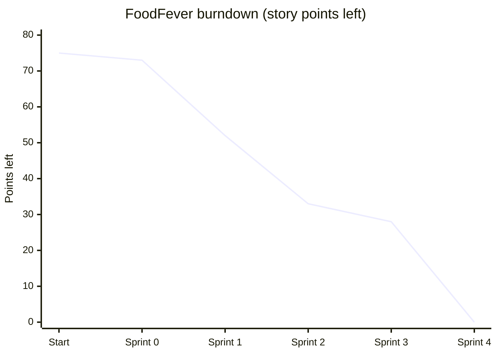

# 3. Methodology and Planning

## 3.1 Introduction

This chapter is about how we actually managed the FoodFever project. I'll go through why our group went with Scrum, who did what, how we planned our sprints, what got done in each one, and the risks and problems we ran into along the way.

## 3.2 Why We Chose Scrum

FoodFever is a web app where Strathmore students and staff can order food from the campus cafeteria and have it brought to them at the Student Centre, the hostels, the lecture halls or the library. Vendors have their own dashboard where they see orders coming in and update them as they cook. We built it using Scrum, which is one of the Agile frameworks.

The biggest reason we picked Scrum is that we honestly didn't know all the requirements when we started. Our first prototype was just a menu and a cart. Login, profiles, order tracking, order history, the vendor dashboard and M-Pesa payment all came up later as we kept talking about the idea. Even things we had already planned kept changing once we saw each other's work. For example, the order statuses started as Pending, Preparing and Ready and then we added Delivered, the sign-up form got separate student and vendor roles, and the menu page was redone a couple of times. With Waterfall we would have had to write all of this down and design it before writing any code, and every new idea would have taken us back to the start. With Scrum we just added it to the backlog and picked it up in a later sprint.

The app also split up nicely into modules: menu and cart, ordering and tracking, login and profiles, the vendor dashboard, and payment. That meant each developer could take a module and work on it on their own Git branch at the same time as everyone else, then merge it in with a pull request when it was ready.

We also had a fixed deadline, and short sprints made it easy to see when we were falling behind. Whenever that happened we pushed the less important stuff further down the backlog instead of rushing everything. M-Pesa payment, for example, was a "Could" item, so we left it until the core of the app was working and only built it in the last sprint. A real backend and database never made it in and are now future work.

Lastly, the report is marked together with the system. Because us documentors were in the same sprints as the developers, we could write our chapters while the features were being built instead of trying to remember everything at the end.

Before we settled on Scrum we looked at a few other options:

| Methodology | How it works | Why we didn't pick it |
|---|---|---|
| Waterfall | One phase after another (requirements, design, coding, testing), no going back | Too rigid for us. Changing requirements late is expensive and there's nothing to show until the very end |
| Spiral | Repeated cycles with a lot of focus on risk analysis | Meant for big, high-risk projects. Doing a full risk analysis every cycle was too much for a web app this size |
| Prototyping | Build quick versions of the screens and improve them with feedback | Really useful for the interface, so we did use it inside our sprints, but it doesn't cover the whole project on its own |
| Kanban | Tasks flow across a board continuously, no fixed sprints | No fixed delivery points, and we needed those for the course deadline. We did still use a Kanban-style board, but only to track tasks |
| **Scrum** | Short fixed sprints, a prioritised backlog, clear roles and regular reviews | **What we chose.** It copes with changing requirements, gives us something working at the end of every sprint and lets developers and documentors work side by side |

The Scrum Guide (Schwaber and Sutherland, 2020) describes Scrum as a lightweight framework that rests on three pillars: transparency, inspection and adaptation. For us, transparency came from the shared backlog and our evening updates on WhatsApp, inspection came from testing what had been merged at the end of each sprint, and adaptation came from what we agreed to change in each retrospective.

## 3.3 Team Roles

| Scrum role | Who | What they do |
|---|---|---|
| Product Owner | Harshvir Singh Ahuja | Owns the project and the GitHub repo, decides what goes into each sprint, reviews and merges pull requests |
| Scrum Master | Aaron Kiuna | Runs our meetings, checks on anyone who's stuck and keeps the sprint on track |
| Development team | Harshvir Singh Ahuja, David Kiki, Justin Mukunzi, Keith Muleshe, Ivan Leo | Build and test the features |
| Documentors | Aaron Kiuna, Sahra, Mnadhiri Simeon Charles, Mathew Keah, Allan Mwangi | Write the report, one chapter each |

This is how we split up the report:

| Documentor | Name | Chapter |
|---|---|---|
| 1 | Aaron Kiuna | Introduction and project overview |
| 2 | Sahra | System requirements |
| 3 | Mnadhiri Simeon Charles | Methodology and planning |
| 4 | Mathew Keah | System design |
| 5 | Allan Mwangi | Testing and user guide |

And this is who built what:

| Module | Developer | Branch |
|---|---|---|
| Repo setup, first prototype, README | Harshvir Singh Ahuja | `main` |
| Menu, cart and checkout | David Kiki | `feature/david-menu-cart` |
| Ordering, tracking and order history | Justin Mukunzi | `feature/ordering-and-tracking` |
| Login, sign-up and profiles | Keith Muleshe | `feature/login---sign-in` |
| Vendor dashboard, shared design, contact page | Harshvir Singh Ahuja | `feature/dashboard` |
| M-Pesa payment simulator | Ivan Leo | `feature/mpesa-integration` |
| Pay on delivery, delivery updates, final polish | Harshvir Singh Ahuja | `feature/mpesa-integration` |

Harshvir merged most of our pull requests. Justin merged the first one (David's menu and cart).

## 3.4 How We Ran Each Sprint

At the start of each sprint Aaron, as Scrum Master, called a planning meeting where we agreed on a goal and picked which user stories from the backlog we'd work on. During the sprint we checked in every evening on our WhatsApp group. Everyone posted where they'd reached that day, what they were doing next and whether anything was blocking them. At the end of the sprint we looked at what had been merged, tried it out in the browser and talked about what we should do differently next time.

We only counted a story as done if:

1. it worked in the browser with no errors in the console
2. it was merged through a pull request
3. it still worked with the other modules (for example, the cart still passed the order to checkout properly)
4. the documentors had been told about it so we could update the report

## 3.5 Product Backlog

We used MoSCoW for priority (Must, Should, Could) and story points for size, where 1 is tiny and 8 is big.

| ID | User story | Priority | Points | Sprint |
|---|---|---|---|---|
| PB-01 | As a team, we need a shared repo and a basic page so we can start building. | Must | 2 | 0 |
| PB-02 | As a student, I want to browse the cafeteria menu so I can see what's available. | Must | 3 | 1 |
| PB-03 | As a student, I want to add items to a cart and see the total so I know what I'll pay. | Must | 5 | 1 |
| PB-04 | As a student, I want to choose where my food is delivered (Student Centre, hostels, lecture halls, library). | Must | 3 | 1 |
| PB-05 | As a student, I want to place an order and get a confirmation. | Must | 5 | 1 |
| PB-06 | As a student, I want to track my order so I know when it's coming. | Should | 5 | 1 |
| PB-07 | As a student, I want to see my past orders. | Should | 3 | 2 |
| PB-08 | As a user, I want to sign up and log in so my details stay private. | Must | 5 | 2 |
| PB-09 | As a student or vendor, I want a profile page where I can see and edit my details. | Should | 3 | 2 |
| PB-10 | As a vendor, I want a dashboard showing incoming orders so I can prepare them. | Must | 8 | 2 |
| PB-11 | As a user, I want every page to look the same and have the same navigation so the site is easy to use. | Should | 3 | 3 |
| PB-12 | As a user, I want a contact page so I can send questions to the team. | Could | 2 | 3 |
| PB-13 | As a student, I want to pay with M-Pesa so I don't need cash. | Could | 8 | 4 (simulated) |
| PB-14 | As a student, I want to choose between paying now and paying on delivery. | Should | 5 | 4 |
| PB-15 | As a student, I want an email when my order has been delivered. | Could | 3 | 4 |
| PB-16 | As a user, I want the site to feel smooth and work well on my phone. | Could | 2 | 4 |
| PB-17 | As a team, we want everything tested and the bugs fixed before the demo. | Must | 5 | 4 |
| PB-18 | As a lecturer, I want a complete report and user guide to assess the project. | Must | 5 | 4 |
| PB-19 | As a team, we want the pages connected to a real backend and database so students and vendors see the same orders on different devices. | Could | 8 | Future |

## 3.6 Sprint Plans

We started the project on 25 October and finished on 12 November 2026.

| Sprint | Dates | Goal | Stories |
|---|---|---|---|
| 0 | 25 Oct – 1 Nov | Set up the repo and build a simple prototype | PB-01 |
| 1 | 2 – 5 Nov | A student can browse the menu, fill a cart, check out and track the order | PB-02 to PB-06 |
| 2 | 6 – 9 Nov | Add accounts, order history and the vendor dashboard | PB-07 to PB-10 |
| 3 | 10 Nov | Get every module into `main` under one shared design, and add a contact page | PB-11, PB-12 |
| 4 | 11 – 12 Nov | Add payment and delivery updates, then test everything and finish the report | PB-13 to PB-18 |

In Sprint 0 we set up the repo, agreed to use plain HTML, CSS and JavaScript with no backend, made the `css`, `js` and `docs` folders and built a first version with just a menu and a cart.

Sprint 1 was all about the main ordering flow: the menu page, the cart (adding and removing items, quantities and the total), passing the cart to checkout, and the ordering and tracking module.

In Sprint 2 we added login and sign-up with form validation, student and vendor profiles, order history and the vendor dashboard.

Sprint 3 was only one day. The goal was to get every module into `main`, give all the pages the same look and add a contact page.

Sprint 4 was the last two days before submission. Since the core of the app was working, we brought M-Pesa back up from the bottom of the backlog. We also added a pay on delivery option and email updates, then tested everything and finished the report.

## 3.7 Sprint Progress

| Sprint | Points planned | Points done | Points left in project | Status |
|---|---|---|---|---|
| 0 | 2 | 2 | 73 | Done |
| 1 | 21 | 21 | 52 | Done |
| 2 | 19 | 19 | 33 | Done |
| 3 | 5 | 5 | 28 | Done |
| 4 | 28 | 28 | 0 | Done (12 Nov) |

That's 75 points in total, not counting the backend (PB-19), which is future work. Sprints 1 and 2 came in at about 20 points each. Sprint 4 was bigger because the whole team was pushing to finish and a lot of it built on work that was already there.

### Sprint 0 (25 Oct – 1 Nov)

We kicked off on 25 October. That same day Harshvir created the repo and pushed the first prototype with a menu, a cart and the README. We spent the rest of the week agreeing on the features and sharing out the modules and report chapters. Having something simple running from day one really helped, because everyone was building on the same base. We also agreed that every feature would get its own branch and only go in through a pull request.

### Sprint 1 (2 – 5 Nov)

David Kiki finished the menu, cart and checkout handoff on 3 November, and Justin Mukunzi pushed the ordering and tracking module the next day. Because they were working on connected parts at the same time, the checkout messages didn't match between their two modules at first. They both pushed small fixes on 4 November and that sorted it out. In the retrospective we said that next time we should agree early on what data gets passed from one module to the next.

### Sprint 2 (6 – 9 Nov)

On 7 November Justin connected David's menu and cart to his ordering module, and on 8 November he added order history, both on his own branch. The same day he reviewed David's branch and merged it as Pull Request #1. On 9 November Keith Muleshe pushed login, sign-up and the student and vendor profiles, and Harshvir added the vendor dashboard and hooked it up to the order data (Pull Request #4). One thing went wrong while merging. The dashboard files had a capital letter in their names (`Dashboard.html`), which breaks links on servers that care about upper and lower case, so they had to be renamed. A lot got merged on the last day of this sprint and it was pretty stressful, so we agreed to merge smaller pieces earlier from then on.

### Sprint 3 (10 Nov)

At the end of Sprint 2 we noticed that Justin's ordering and tracking work was still sitting on his branch and had never actually been merged into `main`. So it went in on 10 November as Pull Request #2, and Justin fixed the orders page navigation and layout the same day. Harshvir merged Pull Request #5, which added a shared stylesheet (`theme.css`) and script (`shell.js`) so every page has the same navigation bar, footer and look, plus the contact page. The Dashboard link now only shows up when a vendor is logged in. My first version of this chapter was merged as Pull Request #6.

### Sprint 4 (11 – 12 Nov)

Ivan Leo built an M-Pesa payment simulator. It takes the student's phone number, pretends to send the STK push and asks for a PIN. While bringing it in he also sorted out the merge conflicts in `index.html` and fixed a script tag with the wrong letter casing. Justin merged the main pages with his tracking work on the `develop` branch (Pull Request #8), and Ivan's work went into `develop` as Pull Request #9.

Harshvir then finished the payment side. Orders are now only created after the payment goes through, and the M-Pesa receipt shows on the vendor dashboard. Students can choose between "Pay now" and "Pay on delivery", and we added a fourth status, Delivered. For pay on delivery orders, the vendor collects the payment when they mark the order as delivered. He also added an email update for when an order is delivered (using EmailJS, since we don't have a backend), a short animation that shows the order being cooked and delivered, a new reveal animation for the menu, and a menu button for phones. A few file names had capital letters again (`Delivery.js` and `Notify.js`), so those were renamed to lowercase as well. Everything was merged into `main` on 12 November as Pull Request #10.

Over the same two days the documentors finished their chapters. Aaron did the introduction, Sahra the requirements, I updated this chapter, Mathew did the design diagrams and Allan did the testing and user guide.

## 3.8 Tools

We used GitHub for version control. Our repo has a `main` branch for the stable version, a `develop` branch for joining modules together, and a `feature/` branch for each module, and every change went in through a pull request. We kept the backlog on the GitHub Issues board, which basically worked as a Kanban board with to do, in progress and done. We wrote the code in VS Code and tested it with the Live Server extension. EmailJS sends the delivery emails straight from the browser. For the design chapter we used draw.io and StarUML for the UML diagrams and dbdiagram.io for the ERD.

For communication we used our WhatsApp group for pretty much everything: the evening check-ins, sending screenshots of bugs and reminding each other about deadlines. We also shared our report chapters there for feedback before saving them in the `docs/report` folder in the repo.

## 3.9 Risk Management

These were the main risks we saw and how we dealt with them:

| Risk | Likelihood | Impact | How we handled it |
|---|---|---|---|
| Team members busy with other coursework | High | Medium | Short evening check-ins instead of long meetings, and small tasks that could be done in a day or two |
| Merge conflicts between modules | Medium | High | Separate feature branches, a `develop` branch for joining things together, and pull requests reviewed before merging |
| Scope growing past the deadline | High | High | MoSCoW priorities, so "Could" items like M-Pesa waited until the core app was working |
| Someone being unavailable | Low | High | All code kept on GitHub so anyone could pick up a module, and progress shared every evening |
| Report left until the last minute | Medium | High | Each documentor got their chapter in Sprint 0 and wrote alongside the developers |

## 3.10 Challenges

Our biggest challenge was that the scope kept growing. Login, profiles, the vendor dashboard and payment weren't in the first plan at all. Having a backlog meant we could slot them into later sprints without breaking what already worked.

Joining modules that were built separately caused a few problems, mostly where the cart hands the order over to checkout and in `index.html`, which almost everyone had to edit. Ivan had to resolve conflicts in that file in Sprint 4. None of it was serious, but it would have been easier if we'd agreed on the shared data and page layout earlier.

File names with capital letters caught us out three times (the dashboard, the home script and the delivery and notify scripts). Things worked on some laptops and broke on others. In the end we agreed that every file name should be lowercase.

We also had a habit of leaving merges until the end of a sprint, which is how Justin's ordering module ended up sitting on its branch for a few days before anyone noticed it wasn't in `main`. Merging smaller changes more often, and checking what's actually in `main` at each sprint review, would have caught that sooner.

Lastly, the app still saves everything in the browser. That means a student's phone and a vendor's laptop can't see the same orders, and the M-Pesa payment is only a simulation. The delivery emails also need the team's EmailJS account details added before they actually send. To launch FoodFever for real, we'd need a proper backend and database (the design is in Chapter 4) and the real M-Pesa API.

## 3.11 Conclusion

Scrum worked well for us. We had a basic ordering system working early and kept adding to it (accounts, order history, the vendor dashboard, and finally payment and delivery updates) without having to plan everything up front. Giving each developer their own module and branch meant five people could build at the same time, and the evening check-ins on WhatsApp meant problems came up early instead of on the last day. Between 25 October and 12 November we finished everything we had planned for this version. The next steps would be connecting a real backend and switching the simulated M-Pesa payment to the real thing.

## References

Beck, K. et al. (2001) *Manifesto for Agile Software Development*. Available at: https://agilemanifesto.org

Schwaber, K. and Sutherland, J. (2020) *The Scrum Guide: The Definitive Guide to Scrum: The Rules of the Game*. Available at: https://scrumguides.org/scrum-guide.html

Sommerville, I. (2016) *Software Engineering*. 10th edn. Harlow: Pearson.
